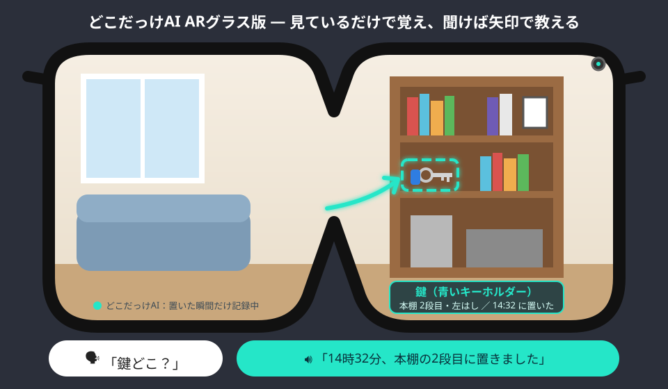

# どこだっけAI ARグラス版（構想・仕様書）

**ARグラスやカメラ付きイヤホンが、見ているだけで「モノを置いた場所」と「やったこと」を覚えておき、「鍵どこ？」と聞けば声と矢印で教えてくれるシステム**の構想と仕様書です。

## 仕様書

👉 **[docs/spec.md](docs/spec.md)**

| 章 | 内容 |
|---|---|
| 1〜3 | 概要、背景と目的、利用者の候補（自分／高齢者と家族／仕事） |
| 4 | 機器の構成（ARグラス・カメライヤホン・スマホ・クラウドのAI） |
| 5 | 機能（**置いた瞬間の自動記録**、声で探す、AR表示、見つからないときの推理、**したっけ記録**、おでかけ前チェック、置き忘れ警告、健康の数値の読み取り、家族共有、プライバシーモード） |
| 6 | 声のやりとりの例 |
| 7〜8 | プライバシーの設計（**見るけれど、残さない**）、安全と非機能の要件 |
| 9〜10 | 段階的な開発計画、課題 |

## 特徴

- **置いた瞬間だけ記録**：手がモノを離した瞬間を端末で判定し、その1枚だけをAIで文字にする。ずっと録画しない
- **映像は残さない**：保存するのは「何を・どこに・いつ」の文字だけ
- **モノ＋したっけ＋健康**：鍵の場所、「鍵閉めたっけ？」、体重計・血圧計の数値をまとめて記録
- **家族で共有**：「リモコン、最後に誰がどこに置いた？」

## 公開の目的

ARグラスやウェアラブルカメラで暮らしを支えたいと考える人や企業は少なくありません。
この構想を自由に参考にしてもらい、**探し物と「やったっけ？」の不安を減らす**ことにつなげたいと考えて公開しています。

## ライセンス

[MIT License](LICENSE)
