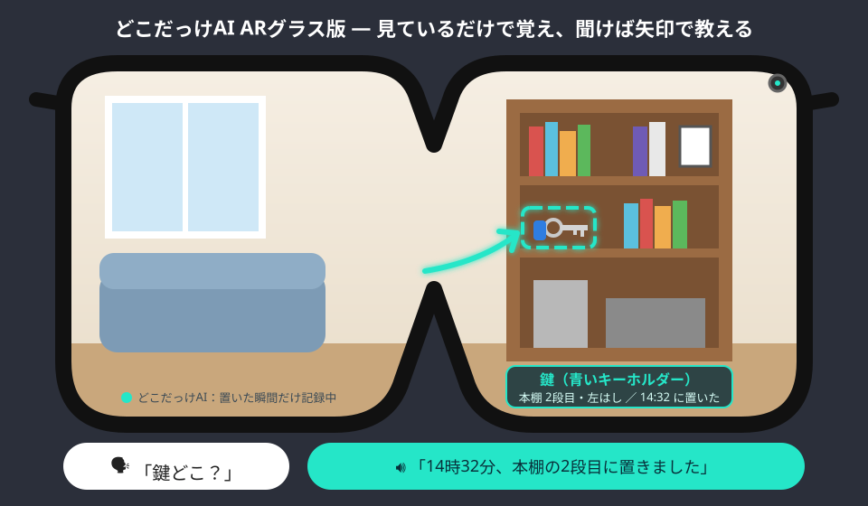

# どこだっけAI ARグラス版 仕様書（第1版）

- 文書の種類：構想・機能仕様書（公開版）
- 作成日：2026-11-10
- 作成者：birdnnjjhiroselittle
- 対象の機器：**ARグラス**、**カメラ付きイヤホン**（どちらもスマホと連携）

---

## 1. 概要

**どこだっけAI ARグラス版**は、身につけたカメラが毎日の暮らしをさりげなく見て、

1. **モノを置いた場所**（鍵・財布・メガネ・リモコン・薬など）
2. **やったかどうか**（鍵を閉めた・薬を飲んだ・ガスを止めた）
3. **家の中の表示の数値**（体重計・血圧計・体温計など）

を**文字にして覚え**、聞かれたら**声とARの矢印で答える**システムです。

スマホ版の「どこだっけAI」は、写真を自分で撮る必要があります。
ARグラス版では**撮る操作をなくし、見ているだけで覚える**ことを目指します。

### ひとことで

> 探し物は「思い出す」ものから「聞けば分かる」ものへ。
> スマホを取り出さず、画面を見ず、**「鍵どこ？」と言うだけ**。



---

## 2. 背景と目的

- 人は探し物に、1日あたり数分から十数分を使っていると言われます。高齢になるほど、置き忘れや「やったっけ？」が増え、不安や家族の負担にもつながります。
- スマホのアプリで記録する方法は、**記録すること自体を忘れる**ので続きません。
- ARグラスやカメラ付きのウェアラブル機器が広がりつつあり、大手企業も「メガネどこに置いた？」に答えるAIのデモや機能を発表しています。

どこだっけAIの目的は、ただモノを見つけるだけでなく、

- **置いた瞬間だけ**を記録して、電池・通信・プライバシーの負担を小さくする
- **モノの場所・やったこと・健康の数値**を1つの記録にまとめる
- **家族で共有**できる（「リモコン、最後に誰がどこに置いた？」）
- **映像は残さず、文字だけ残す**

ことです。

---

## 3. 利用者と利用場面（候補）

おもな利用者はまだ決めていません。次の3つを候補として、試作で比べます。

| 利用者 | 場面 | ほしいこと |
|---|---|---|
| **自分（一般の人）** | 出かける前、家の中、外出先 | 鍵・財布・スマホ・傘をすぐ見つけたい。置き忘れたくない |
| **高齢者と家族** | 自宅、介護施設 | 「やったっけ？」の不安を減らしたい。家族が離れていても様子が分かる（本人の同意つき） |
| **仕事（倉庫・現場・病院など）** | 工具・備品・検体・書類の管理 | 「あの工具どこ？」を減らしたい。持ち出し・戻しを自動で記録したい |

> 決め方の案：自分で2週間使う → 高齢の家族・知人に試してもらう → 仕事向けは企業に聞いてみる。

---

## 4. 機器の構成

```
┌─────────────────────┐      ┌──────────────────┐      ┌─────────────┐
│ ARグラス or カメライヤホン │ BLE/ │ スマホ（中心）        │ 必要 │ クラウドのAI   │
│ ・カメラ                 │ Wi-Fi│ ・手の動きの判定      │ な時 │ ・画像を文字に │
│ ・マイク／スピーカー     │ ───▶ │ ・記録（文字）の保存  │ ───▶ │ ・質問に答える │
│ ・表示（グラスのみ）     │ ◀─── │ ・音声のやりとり      │ ◀─── │              │
└─────────────────────┘      └──────────────────┘      └─────────────┘
```

| 機器 | 役割 | 備考 |
|---|---|---|
| ARグラス | 目線のカメラ、AR表示（矢印・枠）、声 | 理想の形。カメラ映像を外部アプリで使える機種が必要 |
| カメラ付きイヤホン | カメラ、声 | 表示はない。答えは声とスマホの画面。自作なら XIAO ESP32S3 Sense などで試作できる |
| スマホ | 判定・保存・通信の中心 | 最初の試作は「スマホを首から下げる」だけでも可 |
| クラウドのAI | 画像から「何を・どこに」を文字にする、質問に答える | 送るのは「置いた瞬間」の1枚だけ |

---

## 5. 機能一覧

| No. | 機能 | 内容 |
|---|---|---|
| F1 | **置いた瞬間の自動記録** | 手がモノを持つ → 離す、を検出した瞬間だけ1枚撮り、「何を・どこに・いつ」を文字で記録 |
| F2 | **よく探すモノの登録** | 「これは私の鍵」と見せて数枚撮るだけで、自分の鍵・財布・メガネを見分けられるようにする |
| F3 | **声で探す** | 「鍵どこ？」→「14時32分、リビングの本棚の2段目に置きました」 |
| F4 | **ARで場所を示す** | その場にあれば枠で囲む。別の部屋なら「寝室です」と方向の矢印を表示 |
| F5 | **見つからないときの推理** | 最後に見た時刻のあと、どこへ行ったかから候補を順に挙げる（「そのあとキッチンに行きました。冷蔵庫の上かもしれません」） |
| F6 | **したっけ記録** | 鍵を閉めた・ガスを止めた・薬を飲んだ・電気を消した、を記録。「鍵閉めたっけ？」→「8時10分に閉めました」 |
| F7 | **おでかけ前チェック** | 玄関で「財布・スマホ・鍵・定期、そろっています。傘は今日いります」 |
| F8 | **置き忘れ警告** | お店や電車を離れるとき、さっきまで持っていたモノが無いと「傘を置いてきていませんか？」 |
| F9 | **表示の読み取り（健康記録）** | 体重計・血圧計・体温計を見るだけで数値を記録（スマホ版の機能を自動化） |
| F10 | **家族で共有** | 家族の記録をまとめて検索。「リモコン、最後に誰がどこに置いた？」（全員の同意が前提） |
| F11 | **プライバシーモード** | 「見ないで」の一言、またはトイレ・お風呂・他人の家などでカメラを止める |

### F1 置いた瞬間の自動記録（いちばん大事な機能）

ずっと撮ってAIに送ると、電池・通信費・API料金が足りず、プライバシーの心配も大きくなります。
そこで **「手がモノを離した瞬間」だけ** を記録します。

1. カメラは低い解像度・低い頻度で手を見る（端末の中だけで処理）
2. 手の動きを追うツール（例：MediaPipe Hands）で「つかむ → 離す」を判定
3. 離した瞬間の前後1枚を高い解像度で撮る
4. ブレ・暗さ・同じ場面の重なりを端末で捨てる
5. 残った1枚をAIに送り、次のような**文字の記録**に変換
6. 画像は捨てる（設定で、小さな見本写真だけ残すことも可）

```json
{
  "time": "2026-11-10T14:32:05+09:00",
  "type": "place",
  "item": "鍵（自分の、青いキーホルダー）",
  "place": "リビング / 本棚 / 上から2段目 / 左はし",
  "near": ["本", "写真立て"],
  "person": "本人",
  "confidence": 0.86
}
```

1日の記録は数十件程度を想定します。

### F4 ARの表示ルール

- **歩いているときは表示しない**（声だけ）。立ち止まったら矢印を出す
- 表示は視界の端に小さく。モノを囲む枠は3秒で消える
- カメライヤホンの場合は声と、スマホの画面の見本写真で答える

### F6 したっけ記録

あらかじめ「記録したい行動」を選んでおきます（鍵・ガス・薬・窓・電気など）。
動作（鍵を回す、薬を口に運ぶ）を見て記録し、聞かれたら時刻で答えます。
**薬は「飲んだように見えた」という記録であり、確実な服薬の確認ではない**ことを画面と声ではっきり伝えます。

---

## 6. 声のやりとりの例

```
本人： 鍵どこ？
AI ： 14時32分に、リビングの本棚の2段目に置きました。（グラスに矢印）

本人： メガネが見つからない
AI ： 最後に見たのは朝9時、洗面所です。そのあと寝室に行っています。
       洗面台の横か、ベッドの横の台を見てください。

本人： （玄関で）
AI ： 財布とスマホはポケット、鍵は手に持っています。
       今日は夕方から雨なので、傘を持っていきましょう。

本人： 鍵閉めたっけ？
AI ： 8時10分に閉めています。
```

---

## 7. プライバシーの設計

「どこだっけAI」は**見るけれど、残さない**ことを約束します。

| 原則 | 内容 |
|---|---|
| 置いた瞬間だけ | ずっと録画しない。手の判定は端末の中だけで行う |
| 文字だけ残す | AIに送った画像は文字にしたら捨てる。保存するのは「何を・どこに・いつ」だけ |
| 端末の中に保存 | 記録はスマホの中。家族で共有するときも、共有するのは文字の記録だけ |
| 他人を記録しない | 顔は判定に使わず、写り込んだ人はぼかしてから送る |
| 止める場所 | トイレ・お風呂・寝室（設定）・他人の家・お店のレジなどは自動で止める |
| 見せて分かる | カメラが動いているときは、グラスのランプで周りの人に分かるようにする |
| 同意 | 家族・介護での利用は、本人がいつでも止められることが前提。見守る側だけが決めない |

---

## 8. 安全・非機能の要件

| 項目 | 目標 |
|---|---|
| 答えるまでの時間 | 声で聞いてから2秒以内（記録は文字なので速い） |
| 電池 | 朝から夜まで（12時間以上）。カメラは常に低い解像度、撮るのは置いた瞬間だけ |
| 通信量・料金 | 1日数十枚の画像だけをAIに送る。月の料金をはっきり表示する |
| 間違いへの対応 | 自信の低い記録は「たぶん」と言う。答えには必ず時刻をそえる |
| 歩行中の安全 | 歩いているときは画面を出さない |
| 医療 | 健康の数値と服薬の記録は参考用。医療の判断には使わない |

---

## 9. 段階的な開発計画

| 段階 | 機器 | やること |
|---|---|---|
| 0（済） | スマホ | 写真を撮って、モノの場所と数値を記録する PWA（スマホ版どこだっけAI） |
| 1 | スマホを首から下げる | F1「置いた瞬間の自動記録」と F3「声で探す」を追加し、自分で2週間使う |
| 2 | 自作カメラ付きイヤホン | XIAO ESP32S3 Sense などで、耳につけるカメラとスマホをつなぐ |
| 3 | 市販のARグラス | F4 AR表示、F7 おでかけ前チェック、F8 置き忘れ警告 |
| 4 | 家族・施設・職場 | F10 家族共有、利用者を決めて試験運用 |

---

## 10. 課題と未解決の点

- **カメラ映像を自由に使えるARグラスが少ない**：機種ごとに開発の方法が違い、カメラを外部に開放していない機種もある
- **見えない場所に置いたモノ**：引き出しやカバンの中は、手の動きから「入れた」ことだけ記録する
- **似ているモノの見分け**：家族みんなが同じ形の鍵を持っている場合など
- **他の人のモノを動かしたとき**：家族共有のルールが必要
- **周りの人の気持ち**：カメラを付けた人が近くにいることへの抵抗感
- **大手との違い**：「したっけ記録」「健康の数値」「家族共有」「映像を残さない」を強みにする

---

## 11. 関連

- スマホ版：どこだっけAI（写真で記録する PWA、試作）
- 同じ作者の関連構想：
  - [なんだっけAI](https://github.com/birdnnjjhiroselittle/nandakke-ai)（知らない言葉を解説）
  - [かんたんAI親方](https://github.com/birdnnjjhiroselittle/kantan-ai-oyakata)（ARグラスで施工方法と事故防止）
  - [たべものすべてAI](https://github.com/birdnnjjhiroselittle/tabemono-subete-ai)（ウェアラブルカメラで食品ロスを減らす）

---

## ライセンス

[MIT License](../LICENSE)
